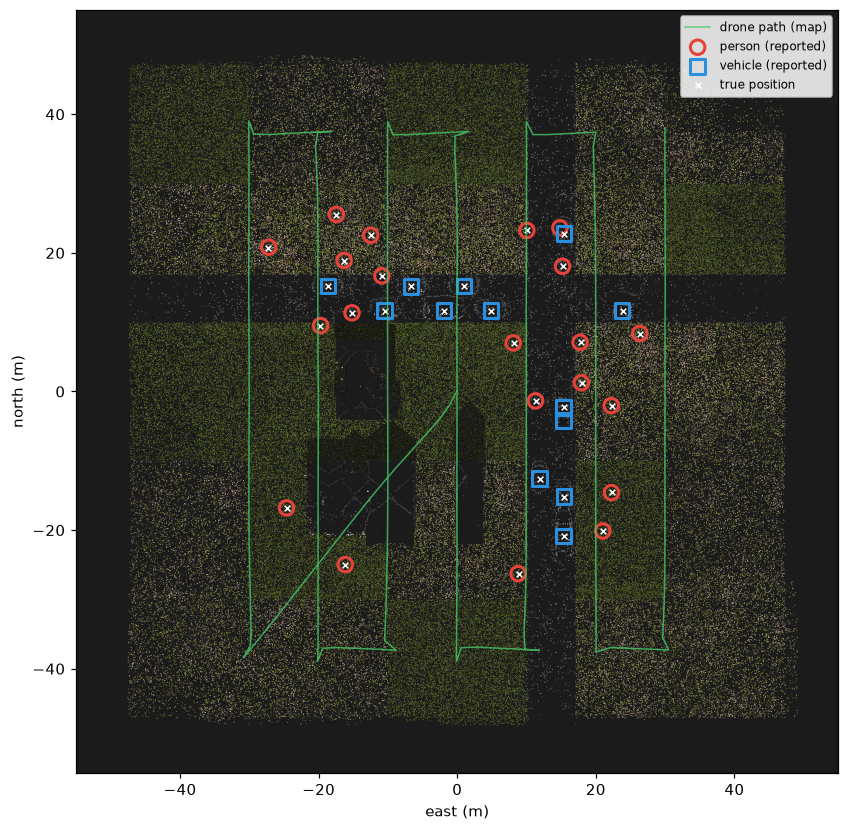
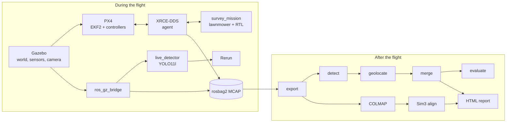
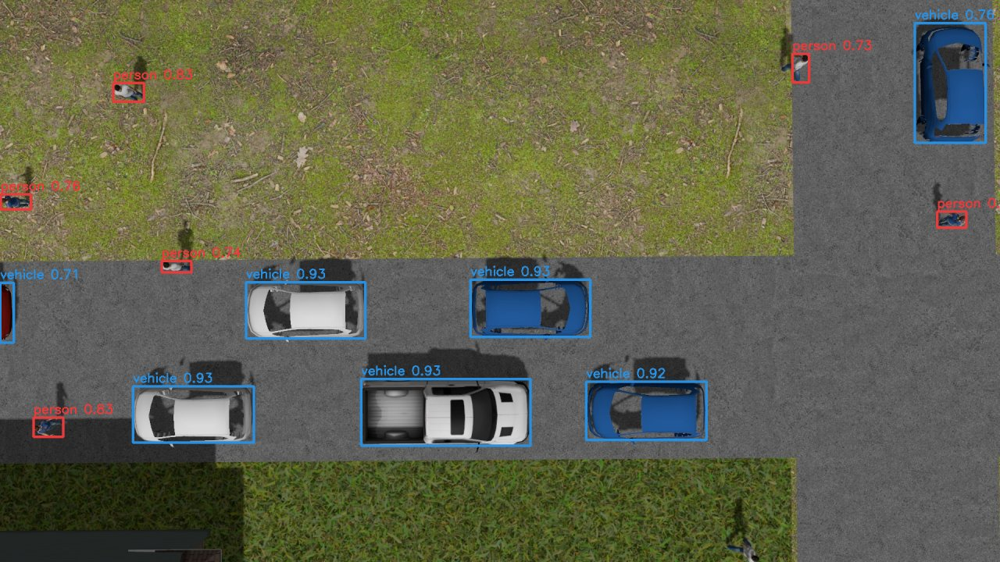
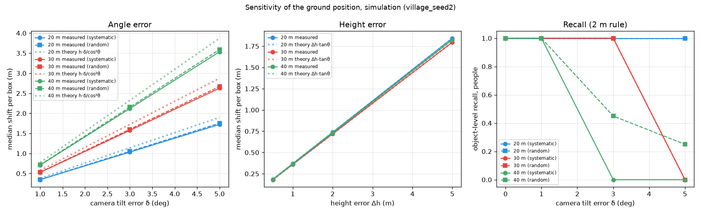
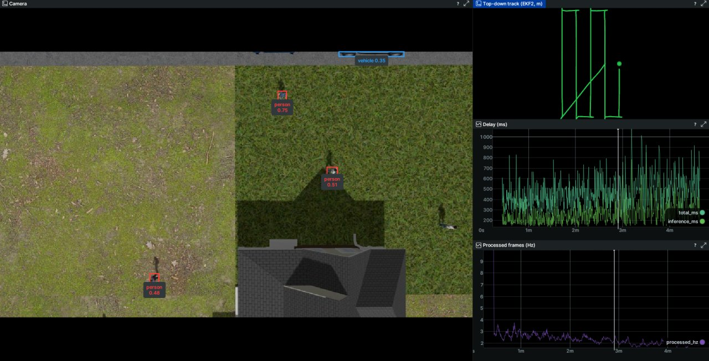

# uav-semantic-mapping

[](https://github.com/oguzzmeric/uav-semantic-mapping/actions/workflows/tests.yml)

An autonomous drone that surveys an area, finds **people and vehicles**, works out where they
are on the ground, builds a 3D map from its own photos and puts the objects on it. Every step is
measured against ground truth, and the position error is broken down into its sources.

Built in simulation (PX4 + Gazebo + ROS 2) with a YOLO11l detector I trained on nadir drone
imagery, and checked on real drone imagery (VisDrone).

**Demo video (1:25):** [youtu.be/k2LMVuSqJFM](https://youtu.be/k2LMVuSqJFM). The 3D map and the
report come from the recorded test flight; the flight in the middle is live, partly at 4× speed.



*Top-down view of the sparse 3D map built from the survey photos and aligned to the world.
Circles: people, squares: vehicles, crosses: true positions. Simulation, held-out test world.*

## Results at a glance

All numbers below come from a **held-out test world** (`village_seed2`): every setting was chosen
on a different development world and frozen before this flight. They are **simulation** results;
see [Limitations](#limitations) for what that does and does not show.

| | People | Vehicles |
|---|---|---|
| Objects found (recall, ≤ 2 m) | **20 / 20** | **12 / 12** |
| Reports that are real objects (precision) | 95.2 % (1 false report) | 92.3 % (1 duplicate) |
| Position error, median / worst | **0.061 / 0.136 m** | **0.065 / 0.132 m** |
| Detection per frame, recall / AP50 | 80.6 % / 0.932 | 97.4 % / 0.970 |

| 3D map | |
|---|---|
| Photos registered | 303 / 303 |
| Cameras to their true positions (not used in the alignment), median | 0.047 m |
| Open ground off its true height, median | 0.058 m |
| Roof heights (true 7.69 / 7.23 / 9.17 m) | 7.67 / 7.19 / 9.78 m |

On **real** drone images the same detector is much weaker: on VisDrone test-dev it finds 26 % of
the people and 58 % of the vehicles (AP50 0.30 / 0.65). The geometry above is only as good as the
detections fed into it.

## How it works



1. **Survey.** A ROS 2 node flies PX4 in offboard mode along a lawnmower path planned from the
   camera's field of view (70 % side and 80 % front overlap at 30 m), with the gimbal pointing
   straight down, then hands over to PX4's return-to-launch.
2. **Record.** Camera frames (JPEG, 10 Hz), the EKF2 pose, the measured gimbal attitude and, in
   simulation only, the true pose go into one MCAP bag on the simulation clock.
3. **Live detection.** A node takes the newest frame whenever the model is free (it is slower
   than the camera, so a queue would only grow), publishes the boxes stamped with the frame's own
   time and shows them in Rerun. Skipped frames are not lost: the recorder has them all.
4. **Detection after the flight.** Every survey frame at full resolution. The official numbers
   come from here.
5. **Geolocation.** Pixel → ray in the camera frame → rotated by the gimbal attitude → cut with
   the plane at half the object's assumed height (the box centre shows the object's middle, not
   its base). The camera position comes from EKF2.
6. **Merging.** Points join the nearest cluster of their class in flight order (the same code
   could run live); boxes cut by the frame edge are left out, and an object needs 5 frames.
7. **Map.** COLMAP (SIFT, on the CPU) builds a sparse 3D map from ~300 photos. EKF2 only chooses
   which photo pairs are compared and drops pairs that disagree with it by more than 5 m; it
   never enters the reconstruction. A Sim(3) fit (Umeyama, ignoring outliers) then puts the map
   in metres and in the world.
8. **Report.** One self-contained HTML page: mission, map, object list, map quality and, when the
   true positions are known, the evaluation.



*A survey frame from 30 m, offline detection (people red, vehicles blue). Simulation.*

## Where the error comes from

Position error per box and per object, people, 30 m (simulation):

| Step | Per box, median | Per object, median |
|---|---|---|
| Truth box + true pose (geometry alone) | 0.050 m | 0.035 m |
| + EKF2 pose estimate | 0.089 m | 0.063 m |
| + model detections (the real system) | 0.090 m | 0.061 m |
| without the object-height correction | 0.331 m | 0.113 m |

The pose estimate adds the most (~4 cm per box), detection ~1 cm. Correcting for the object's
height cuts the per-box error about threefold. 20 m and 40 m give nearly the same table.

**Sensitivity.** In simulation the gimbal attitude is close to perfect, so the error above is
small. To see what a real gimbal would do, the camera was tilted by δ and its height offset by Δh:



- The shift grows linearly with altitude and angle and sits about 9 % under h·δ/cos²θ, which is
  an upper bound (it holds for objects in the plane of the tilt).
- A **systematic** tilt is not averaged away by merging: once h·δ passes the 2 m match limit,
  objects stop matching (30 m: 5°, 40 m: 3°). In practice the gimbal must be better than about
  2 m / h, i.e. 3.8° at 30 m.
- A **random** tilt per frame shrinks about fivefold in merging while it is small (30 m, 1°:
  0.54 → 0.11 m), but once it nears the merge radius the clusters split.
- A height error shifts each box by exactly Δh·tanθ, yet mostly cancels at object level,
  probably because each object is seen from both sides.

## Altitude

| | 20 m | 30 m | 40 m |
|---|---|---|---|
| Survey time | 229 s | 175 s | 159 s |
| Person size in the image | 73 × 56 px | 47 × 37 px | 35 × 28 px |
| Detection per frame, people: precision / recall | 0.86 / 0.82 | 0.95 / 0.81 | 0.94 / 0.71 |
| Objects found, people / vehicles | 20/20, 12/12 | 20/20, 12/12 | 20/20, 12/12 |
| Position error, people, median | 0.070 m | 0.061 m | 0.066 m |

Per frame, small people are missed more often at 40 m, and false alarms rise at 20 m. Splitting
each frame into two full-resolution tiles recovers most of the 40 m loss per frame (recall 0.71
→ 0.87) at three times the cost, but changes nothing at object level, so the pipeline runs on
whole frames.

## Live system

On a laptop GTX 1650 (4 GB) shared with the Gazebo renderer, PyTorch fp32 at 1280 px:
**2.3 frames/s** processed out of 10, median **0.43–0.51 s** from capture to published boxes,
**2.5 GB** of GPU memory in total (detector 0.7 GB). Inference slows during a flight (about
220 → 340 ms per frame); without ROS and Gazebo the detector runs at 110 ms per frame with almost
no drift, so the slowdown comes from the rest of the running system (ROS or the simulation; not
yet separated), not from the model. TensorRT was not used.



*Live view in Rerun during a simulated flight. One person at the shadow's edge is missed in this
frame.*

## Real data: VisDrone

Same detector, same rules (IoU ≥ 0.5, score ≥ 0.25, whole frames). Classes: people ← pedestrian,
people; vehicles ← car, van, truck, bus, motor; bicycles, tricycles, ignored regions and "others"
count neither way.

| Set | Class | Precision | Recall | AP50 | AP50-95 |
|---|---|---|---|---|---|
| test-dev (1610 images) | people | 0.687 | 0.262 | 0.301 | 0.125 |
| | vehicles | 0.850 | 0.577 | 0.646 | 0.411 |
| train (6471 images) | people | 0.722 | 0.380 | 0.423 | 0.189 |
| | vehicles | 0.856 | 0.548 | 0.616 | 0.395 |

The model was trained on nadir drone images, while most VisDrone images are oblique and crowded.
Its training data is not fully documented, so the train set was evaluated too: people score
higher on train (AP50 +0.12) but vehicles do not (−0.03). That is a weak hint that some VisDrone
images were seen in training, not evidence.

## Limitations

- **Simulation.** The village is easy: a flat ground, open space, 32 objects at least 4 m apart,
  and every object seen in dozens of frames. Object-level recall is 100 % at every altitude, so
  this world cannot tell the settings apart at that level.
- **A near-perfect gimbal.** The simulated gimbal attitude has almost no error; the sensitivity
  study shows what a real one would add.
- **Detection on real images is much weaker** than in simulation (see VisDrone). The geolocation
  and map have not been tested on real flights: no telemetry-equipped real dataset was used.
- **Known failure cases.** The same car is reported as a person at 20 m and 30 m (and at 40 m
  with tiling), and a 5 m SUV was reported twice, probably because the merge radius is 2 m.
- **The map needed help.** The village's ground tiles repeat every 20 m and COLMAP matched them
  as the same place, folding the map (cameras 21 m off). EKF2-based pair rejection fixed it, at
  the cost of some independence between the map and EKF2.
- **Not done:** TensorRT, live geolocation on the drone, map accuracy at building corners.

## Running it

Ubuntu 24.04, ROS 2 Jazzy, Gazebo Harmonic, PX4 v1.17.0 SITL, Micro XRCE-DDS Agent v2.4.3. In
short:

```bash
setup/px4_overlay.sh && setup/fetch_textures.sh          # once
uv sync --group detect --group map --group report        # Python environment (.venv)
python3 sim/gz_worlds/make_village.py --seed 2 --name village_seed2
python3 tools/fly_survey.py --world village_seed2 --altitude 30 --name village_seed2_alt30

E=data/export/village_seed2_alt30; O=sim/gz_worlds/village_seed2_objects.csv
.venv/bin/python tools/truth_boxes.py $E $O
.venv/bin/python tools/detect_offline.py $E --run full_frame
.venv/bin/python tools/geolocate.py $E $O --run full_frame
.venv/bin/python tools/merge_objects.py $E --located full_frame_ekf
.venv/bin/python tools/eval_objects.py $E $O --located full_frame_ekf
.venv/bin/python tools/build_map.py $E && .venv/bin/python tools/align_map.py $E --objects $O
.venv/bin/python tools/report.py $E --truth $O              # -> $E/report.html
```

**Model weights are not included.** Put your own YOLO weights at `models/yolo11l_nadir.pt`, or use an
open YOLO11 model and adapt the class mapping in `usm_core/detection.py`.

The core math (`usm_core/`) is plain Python with no ROS dependency; its 94 tests run on every push.

## Repository

```
usm_core/      geolocation, merging, metrics, Sim(3), projection, detection wrapper (+ tests/)
ros/           usm_mission (survey flight, bridge and recording launch files),
               usm_detection (live detector)
tools/         flight automation, export, detection, evaluation, map, report, analysis
sim/           generated village worlds and their ground truth, Gazebo models, PX4 airframe
setup/         PX4 overlay and patches, texture download, simulation start
```

## Licenses and credits

The repository is **AGPL-3.0** (it uses Ultralytics YOLO). PX4 is BSD-3; ROS 2 and Gazebo Apache
2.0; COLMAP BSD; Rerun MIT/Apache 2.0. The simulated people, vehicles and houses are Gazebo Fuel
models by OpenRobotics (CC0, one CC BY 4.0) and the ground textures come from ambientCG (CC0); see
[sim/gz_worlds/CREDITS.md](sim/gz_worlds/CREDITS.md). VisDrone is for non-commercial research and
is not redistributed here. All images in this README are renders of the simulation.

## Next

C++/Eigen geolocation as a ROS 2 node, compared with the Python version; tracking (ByteTrack); a
real flight, if a drone becomes available; a harder simulated world, so that object-level results
can tell settings apart.

---

Oğuz Umut Meric. Earlier work: [monocular visual odometry for GPS-denied drones](https://github.com/oguzzmeric/monocular-vo-scale-study).
